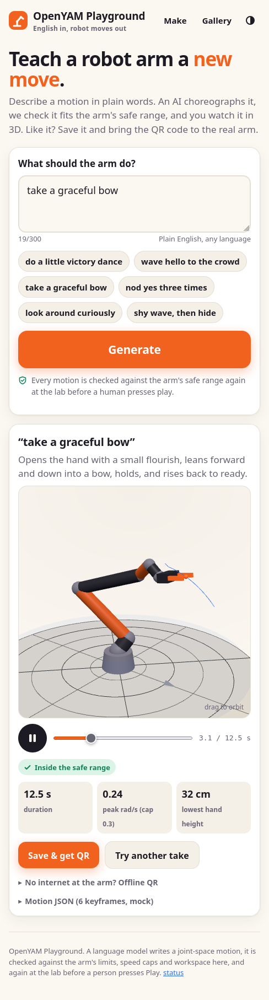

# OpenYAM Playground (public web app)

**Repo:** https://github.com/Nhajela/openyam-playground (public). **Status:** built and tested locally (2026-10-16), **not deployed yet**.

People type English ("do a little victory dance"), a language model writes a *playable* (the same JSON motion format the lab arm runs), the site validates it against the arm's safe range and geometry, shows it in 3D, and gives a QR code to bring to the arm. At the lab the operator scans it; the motion is **re-validated** here and only plays after a human presses Play.



## Files in this folder

| File | What |
|---|---|
| [SPEC-v1.md](SPEC-v1.md) | Copy of the public LLM-facing playable spec v1.0.0 (point your own AI at it; source: `site/spec/v1.md` in the playground repo) |
| [PLAYGROUND-README.md](PLAYGROUND-README.md) | Full copy of the playground repo's README: architecture, stack, env vars, LLM providers, API, data model, validator/FK verification, license check |
| [DEPLOY.md](DEPLOY.md) | Deploy checklist for the Coolify host (serenity), step by step |
| [STATION.md](STATION.md) | How the lab arm consumes a playground motion (QR → fetch → re-validate → preview → play) |
| `screenshots/` | Phone and desktop screenshots (app UI only) |

## How it relates to this repo

```
playground (public)                      this repo (lab, on the arm laptop)
-------------------                      ---------------------------------
English → LLM → playable JSON            armctl/playable.py  (Python validator, the authority)
TS port of the validator  ── matches ──▶ same rules: soft limits, caps, duration, eases
TS forward kinematics     ── matches ──▶ pinocchio on yam.urdf (within 0.1 mm, 35 poses)
GET /api/p/<id>  or  /p/local#<data> ──▶ station: fetch, re-validate, preview, operator Play
                                          → experiments/2026-10-16-linux-real-arm/session_play.sh
```

- The playground's validator is a port; **the lab's Python validator decides**. A motion that passes online can still be refused at the arm.
- It renders a procedural arm, not the i2rt meshes (no license found for them; see PLAYGROUND-README.md "License check").
- Its LLM prompt includes forward kinematics (tip positions per pose and per-joint tip deltas), fixing the "bow that lifts" mistake found in the lab (see `experiments/2026-10-16-linux-real-arm/LOG.md`).
